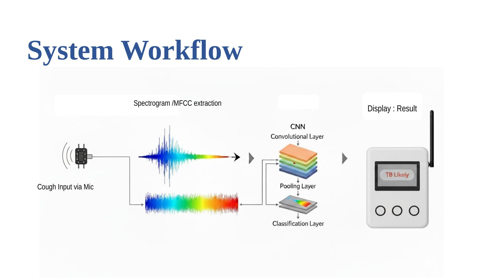
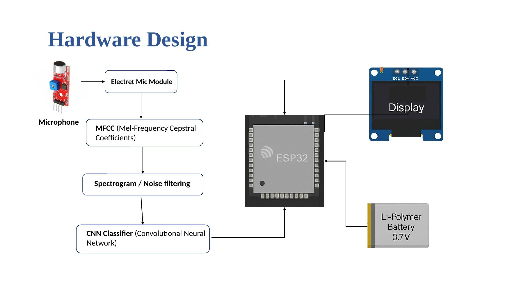
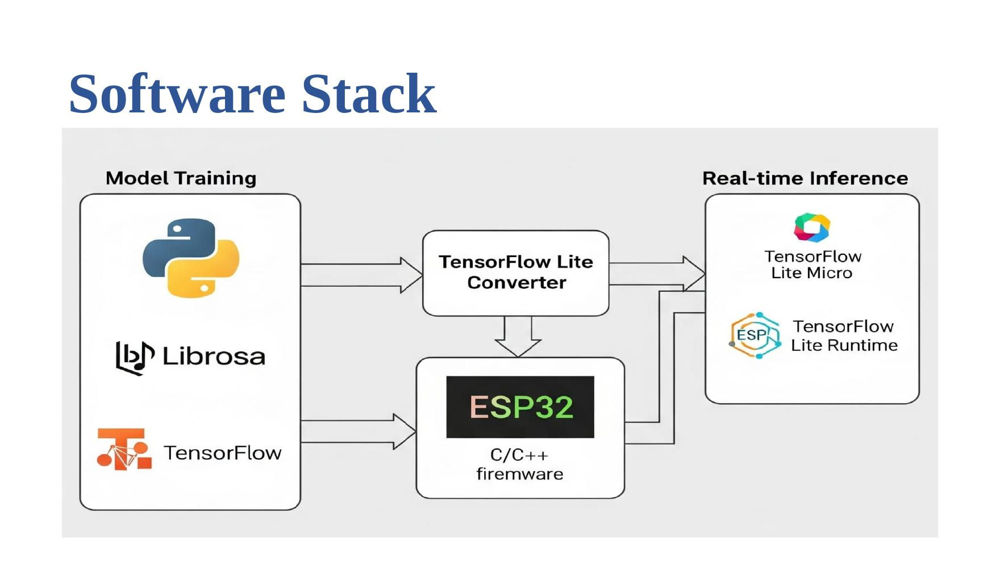

# Cough Sense: AI-Powered Smart Cough Analyzer for Early TB Pre-Screening

AI-based cough analysis system for TB screening using audio signal processing and machine learning.

> **Disclaimer:** This is a research and academic prototype intended only as a **pre-screening aid**. It is **not** a medical device and does **not** replace sputum tests, GeneXpert, chest X-ray or a doctor's diagnosis.

**Institution:** Department of Biomedical Engineering, V.S.B. Engineering College, Karur (Anna University)
**Guide:** Mrs. A. P. Swarnalatha, M.E., HOD, Biomedical Engineering

---

## Problem Statement

Tuberculosis remains among the top ten global causes of death, and India carries nearly 28% of the global burden. Standard diagnostics such as sputum tests and GeneXpert are invasive and costly, and chest X-rays need infrastructure and trained specialists. This leaves a diagnostic gap in rural and low-resource settings, delaying treatment and increasing transmission.

## Why Cough?

Cough is one of the earliest and most consistent symptoms of pulmonary TB. Research suggests TB-related coughs carry acoustic patterns that can be distinguished from other respiratory conditions. Cough analysis is fast, painless and stigma-free, which suits community screening.

## Proposed Solution

A portable, low-cost device that:

1. Records cough sound through a microphone
2. Extracts acoustic features (MFCC / spectrogram) after noise filtering
3. Runs a lightweight CNN on an ESP32 (TensorFlow Lite Micro)
4. Displays the pre-screening result on an OLED display, **offline**, with no internet or lab needed

## System Workflow



## Hardware Design



| Component | Purpose |
|---|---|
| ESP32 | Main microcontroller, runs the TFLite Micro model |
| Electret microphone module | Cough audio input |
| OLED display | Shows result |
| Li-polymer battery (3.7 V) | Portable power |

Details: [hardware/README.md](hardware/README.md)

## Software Stack



- **Model training (PC):** Python, Librosa, TensorFlow
- **Conversion:** TensorFlow Lite Converter (int8 quantization)
- **Real-time inference (device):** TensorFlow Lite Micro, C/C++ firmware on ESP32

## Repository Structure

```
smart-cough-analyzer-tb-screening/
├── README.md
├── LICENSE
├── requirements.txt
├── .gitignore
├── code/
│   ├── config.py               # shared settings
│   ├── feature_extraction.py   # audio -> MFCC features
│   ├── train_model.py          # train CNN classifier
│   ├── convert_to_tflite.py    # quantize + export for ESP32
│   ├── predict.py              # test the model on a .wav file
│   └── server.py               # Flask server: serves the app + runs the model
├── app/
│   └── index.html              # Kaasa IQ mobile web app (single file)
├── hardware/                   # components, wiring notes
├── docs/                       # presentation, reports
├── images/                     # diagrams and results
└── data/                       # sample data only (see data/README.md)
```

## Kaasa IQ Mobile App

A mobile-friendly web app for field screening. Flow:

1. Welcome screen
2. Patient demographics (gender, age range)
3. Risk triage questions (cough > 2 weeks, fever, night sweats, weight loss)
4. Cough recording (single 5 s sample, live level meter)
5. Result screen with waveform, patient profile, interpretation, Retest / Share

Run it:

```bash
python code/server.py            # open http://localhost:5000
python code/server.py --https    # to use from a phone on the same WiFi
```

The browser records audio and sends it to `server.py`, which uses the **same MFCC pipeline as training** and the model in `models/cough_cnn.keras`. If no trained model is present, the app still runs but shows "AUDIO MODEL NOT CONNECTED" instead of a TB score. The flag threshold is `THRESH` at the top of the script in `app/index.html`; tune it on validation data.

## Getting Started

```bash
git clone https://github.com/Gopinath-Biomedical/smart-cough-analyzer-tb-screening.git
cd smart-cough-analyzer-tb-screening
pip install -r requirements.txt
```

1. Put labelled `.wav` files in `data/raw/tb/` and `data/raw/non_tb/` (see [data/README.md](data/README.md))
2. Extract features: `python code/feature_extraction.py`
3. Train: `python code/train_model.py`
4. Export for ESP32: `python code/convert_to_tflite.py`
5. Test on a file: `python code/predict.py path/to/cough.wav`

> The scripts in `code/` are a working pipeline template. Results depend entirely on the dataset you train on. Report your own measured accuracy, sensitivity and specificity below once you have them.

## Results

_To be added: accuracy, sensitivity, specificity, confusion matrix, ROC curve, model size and inference time on ESP32._

## Feasibility

- **Technical:** lightweight models can run on ESP32-class microcontrollers
- **Economic:** target build cost under ₹2000, no recurring consumables
- **Operational:** simple interface for field health workers with minimal training

## Target Users

ASHA / ANM workers and PHC staff, rural clinics and mobile health camps, NGOs and government TB programmes. Beneficiaries are rural and low-income populations, especially children and the elderly.

## Innovation

- Completely non-invasive
- Low-cost, portable and works offline
- AI-powered, can improve as more data is added
- Scalable to mobile apps or handheld devices
- Instant pre-screening compared with hours or days for conventional tests

## Future Work

- Collect and validate on clinically labelled cough data
- Clinical validation with medical supervision and ethics approval
- Extend to other respiratory diseases
- Mobile app version

## Ethics and Data

No patient data is included in this repository. Any real recordings must be collected with informed consent and ethical approval, and anonymized before sharing.

## Reference

- World Health Organization (WHO). *Global Tuberculosis Report 2023.* Geneva: WHO; 2023.

## Team

- C Naveen Kumar
- S P Tharanithar
- S Vengata Prasath
- A Gopinath ([@Gopinath-Biomedical](https://github.com/Gopinath-Biomedical))

## License

MIT License, see [LICENSE](LICENSE).
